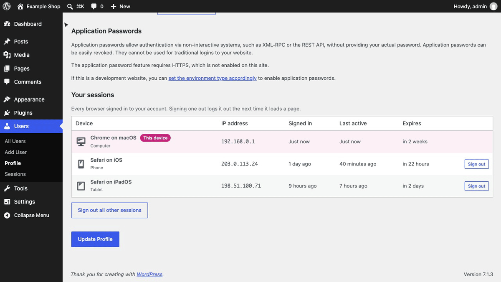
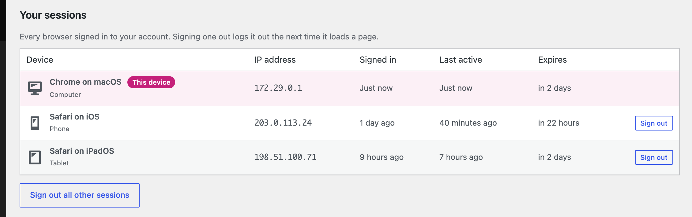
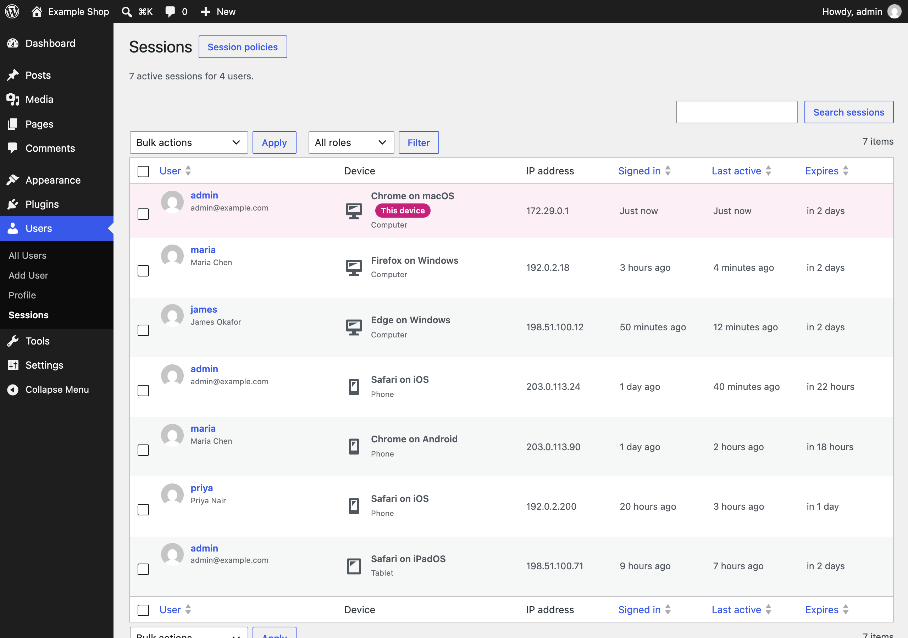
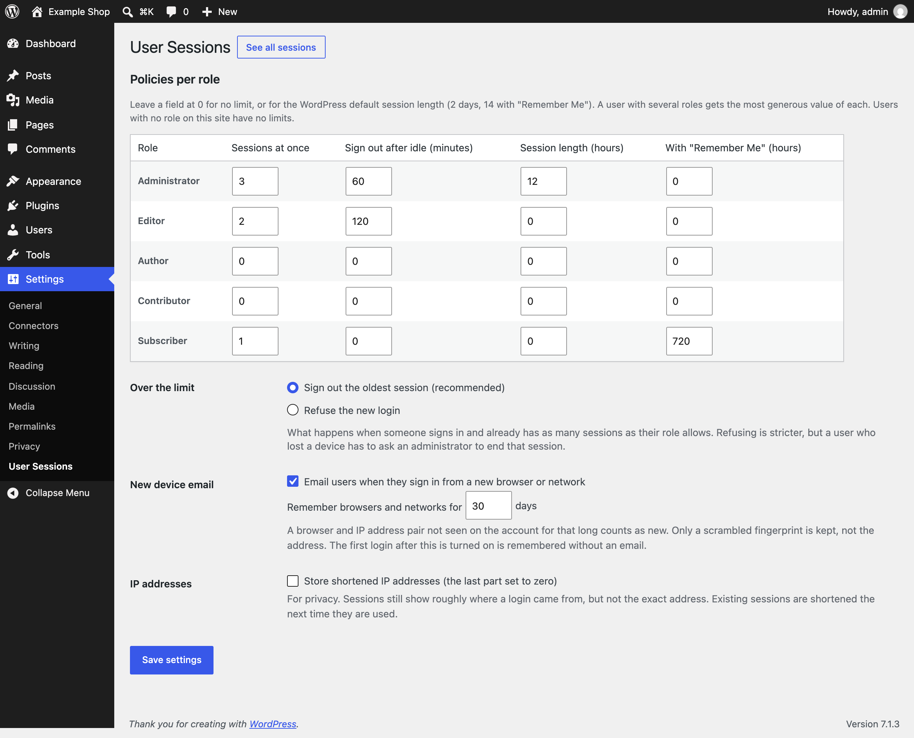
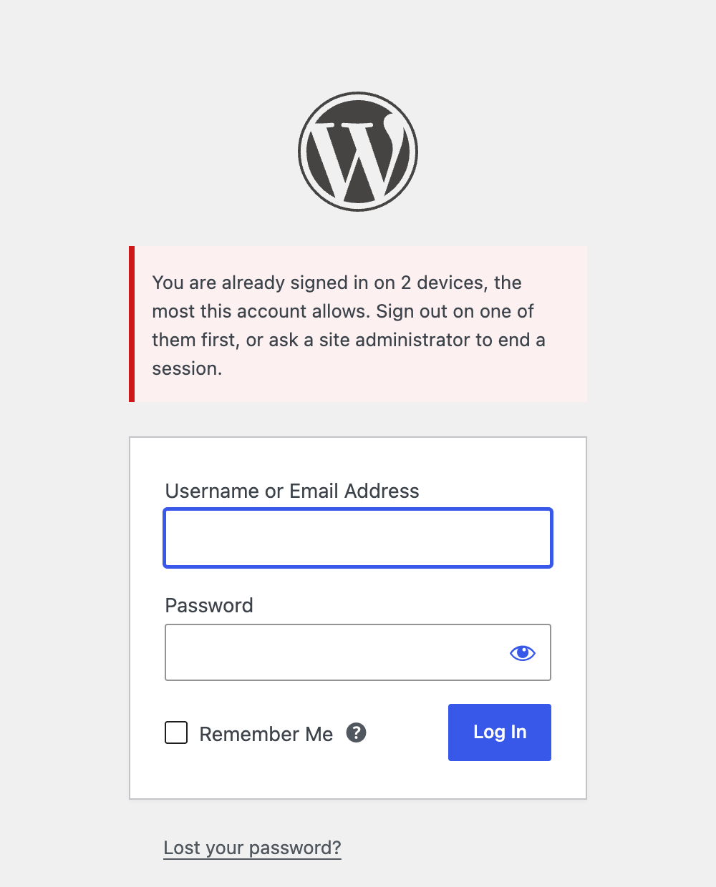

<h1 align="center">User Session Manager</h1>

<p align="center">
  <a href="https://playground.wordpress.net/?blueprint-url=https://raw.githubusercontent.com/aryanjasala/user-session-manager/main/blueprint.json"></a>
  <a href="https://github.com/aryanjasala/user-session-manager/releases/latest"></a>
  
  
  <a href="LICENSE.md"></a>
  <br>
  <a href="https://github.com/aryanjasala/user-session-manager/actions/workflows/phpcs.yml"></a>
  <a href="https://github.com/aryanjasala/user-session-manager/actions/workflows/phpstan.yml"></a>
  <a href="https://github.com/aryanjasala/user-session-manager/actions/workflows/unit-tests.yml"></a>
  <a href="https://github.com/aryanjasala/user-session-manager/actions/workflows/e2e-tests.yml"></a>
  <a href="https://github.com/aryanjasala/user-session-manager/actions/workflows/plugin-check.yml"></a>
</p>

<p align="center">See every device signed in to WordPress, sign out the lost phone, and limit sessions per role.</p>

<p align="center">
   Sessions" width="880">
</p>

---

WordPress already records every login: the browser, the IP address, when it started and when it ends. It just never shows it, and the only control is "Log Out Everywhere Else" on your own profile. User Session Manager lists those sessions on each profile and across the site, signs out any one of them, and adds per-role limits, an idle timeout and a new device email.

> [!NOTE]
> Free and open source under the GPL. No pro version, no upsells, no ads in wp-admin, no tracking. And it stays that way.

## Features

- **Your sessions** on every profile: device, IP address, signed in, last active, expires, and "This device" on the current one
- **Sign out** one session, or every session except this one
- **Users > Sessions**: every active session on the site, with search by user or IP, a role filter, sorting, paging and bulk sign out
- **Sessions column** on the Users list, linked to each user's sessions
- **Per-role policies**: sessions at once (sign out the oldest or refuse the login), idle timeout, and session length with and without "Remember Me"
- **New device email** when someone signs in from a browser and network not seen in 30 days
- **Privacy**: export and erase tools, privacy policy text, and shortened IP addresses on request
- **Abilities** for AI agents, **WP-CLI** for everything, and a **Site Health** check

## Install

1. Download `user-session-manager.zip` from the [latest release](https://github.com/aryanjasala/user-session-manager/releases/latest).
2. In WordPress, go to **Plugins > Add New Plugin > Upload Plugin**, choose the zip and activate it.

Or with WP-CLI:

```sh
wp plugin install https://github.com/aryanjasala/user-session-manager/releases/latest/download/user-session-manager.zip --activate
```

Needs WordPress 6.6+ and PHP 7.4+. To try it first, the **Try in WordPress Playground** badge opens a throwaway WordPress in your browser with the plugin and some demo content.

## Quick look

Set a policy for a role, then find and sign out a session from the command line:

```sh
wp user-session-manager set-policy administrator --max-sessions=2 --idle-minutes=30
wp user-session-manager list --user=maria
wp user-session-manager revoke 7-9f86d081884c7d659a2feaa0
```

A handle like `7-9f86...` is an HMAC of the session, so the token and the stored verifier never appear on a page, in WP-CLI output or in an ability response.

## Screenshots

<table>
  <tr>
    <td width="50%" valign="top"> Your sessions, with the current device marked"><br><sub>Profile > Your sessions, with the current device marked</sub></td>
    <td width="50%" valign="top"> Sessions with every signed-in device on the site"><br><sub>Users > Sessions with every signed-in device on the site</sub></td>
  </tr>
  <tr>
    <td width="50%" valign="top"> User Sessions with policies per role"><br><sub>Settings > User Sessions with policies per role</sub></td>
    <td width="50%" valign="top"><br><sub>A login refused over the session limit</sub></td>
  </tr>
</table>

## Documentation

| Doc | What it covers |
| --- | --- |
| [Reference](docs/REFERENCE.md) | How sessions are read and ended, policies, hooks, abilities, WP-CLI, data and privacy |
| [Development](docs/DEVELOPMENT.md) | Local setup, commands and tests |
| [Contributing](docs/CONTRIBUTING.md) | Pull requests, required checks and PR titles |
| [Releasing](docs/RELEASING.md) | How merged pull requests become releases |
| [Security](docs/SECURITY.md) | Reporting a vulnerability |
| [readme.txt](readme.txt) | What WordPress.org shows, with the FAQ and changelog |

## Project structure

```
user-session-manager.php   plugin header and PSR-4 autoloader
src/
├── Plugin.php             creates the services
├── Settings.php           the settings and the policy for each user
├── Sessions.php           reads and ends sessions in session_tokens, handles
├── UserAgent.php          the small browser and device parser
├── Activity.php           last active, and the idle timeout
├── Limits.php             session limit and length at login
├── NewDevice.php          the new device email
├── Pruner.php             the hourly clean-up
├── Privacy.php            export, erase and policy text
├── Access.php             who may see and end whose sessions
├── Abilities.php          abilities for AI agents
├── Admin/                 profile section, Users > Sessions, Users column, settings
├── Health/SiteHealth.php  the Site Health check
└── Cli/Command.php        wp user-session-manager
assets/admin.css
tests/
├── Unit/                  PHPUnit
└── e2e/                   Playwright specs and the Docker site
.wordpress-org/            screenshots
docs/                      reference, development, contributing, releasing
```

## More free plugins

Small plugins that each fill one gap in WordPress, all free with no pro version:

| | Plugin | What it does |
| --- | --- | --- |
|  | [Page Template Usage](https://github.com/aryanjasala/page-template-usage) | See which template every page uses, and fix the pages on a missing template |
|  | [Staging Guard](https://github.com/aryanjasala/staging-guard) | Stops staging copies from emailing real people or getting indexed |
|  | [Category & Tag Trash](https://github.com/aryanjasala/category-tag-trash) | A trash for categories, tags and custom terms, with undo and full restore |
|  | [Site Read-Only Mode](https://github.com/aryanjasala/site-read-only-mode) | Read-only mode for WordPress during migrations and deploys |
|  | [Restore Blocks from Revisions](https://github.com/aryanjasala/restore-blocks-from-revisions) | Restore a single block from an old revision, not the whole post |

## License

[GPL-2.0-or-later](LICENSE.md) © Aryan Jasala
